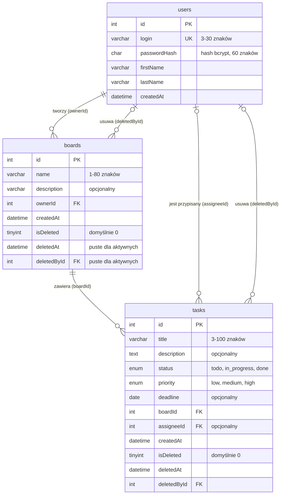

# Opis danych TaskBoard

## Co aplikacja przechowuje

### Użytkownik

Użytkownik loguje się do TaskBoard i może tworzyć tablice oraz być przypisany do zadań.

| Informacja | Przykład |
| --- | --- |
| Identyfikator | `1` |
| Login (unikalny) | `anna.nowak` |
| Hasło zapisane jako hash bcrypt | `[hash bcrypt, 60 znaków]` |
| Imię | `Anna` |
| Nazwisko | `Nowak` |
| Data utworzenia konta | `2026-10-27 09:00:00` |

### Tablica

Tablica grupuje zadania związane z jednym tematem. Na liście tablic widać nazwę, opis, osobę tworzącą oraz liczbę aktywnych zadań.

| Informacja | Przykład |
| --- | --- |
| Identyfikator | `2` |
| Nazwa | `Aplikacja TaskBoard` |
| Opis | `Zadania zespołu przy budowie aplikacji` |
| Identyfikator właściciela (`ownerId`) | `1` |
| Data utworzenia | `2026-10-27 09:15:00` |
| Czy usunięta | `false` |
| Data usunięcia | `null` |
| Identyfikator osoby usuwającej (`deletedById`) | `null` |

### Zadanie

Zadanie jest kartą na tablicy. Karta pokazuje tytuł, priorytet, termin i przypisaną osobę; szczegóły zawierają też opis, status oraz datę utworzenia.

| Informacja | Przykład |
| --- | --- |
| Identyfikator | `17` |
| Tytuł | `Uzupełnić README` |
| Opis | `Dodać opis projektu i instrukcję uruchomienia` |
| Status | `todo` (do zrobienia) |
| Priorytet | `medium` (średni) |
| Termin | `2026-11-06` |
| Identyfikator tablicy (`boardId`) | `2` |
| Identyfikator przypisanej osoby (`assigneeId`) | `1` |
| Data utworzenia | `2026-11-03 09:30:00` |
| Czy usunięte | `false` |
| Data usunięcia | `null` |
| Identyfikator osoby usuwającej (`deletedById`) | `null` |

## Powiązania

Jeden użytkownik może utworzyć wiele tablic, a każda tablica ma jednego właściciela wskazanego przez `ownerId`. Jedna tablica może zawierać wiele zadań, ale każde zadanie należy do dokładnie jednej tablicy wskazanej przez `boardId`. Zadanie może być nieprzypisane albo mieć jedną przypisaną osobę przez `assigneeId`, a jeden użytkownik może być przypisany do wielu zadań. Usunięcie jest logiczne: rekord pozostaje w bazie, a `isDeleted`, `deletedAt` i `deletedById` opisują, czy, kiedy i przez kogo został usunięty.

## Przykład zadania w JSON

```json
{
  "id": 17,
  "title": "Uzupełnić README",
  "description": "Dodać opis projektu i instrukcję uruchomienia",
  "status": "todo",
  "priority": "medium",
  "deadline": "2026-11-06",
  "boardId": 2,
  "assigneeId": 1,
  "createdAt": "2026-11-03T09:30:00",
  "isDeleted": false,
  "deletedAt": null,
  "deletedById": null
}
```

## Wstępny diagram ERD

Typy i powiązania poniżej odpowiadają wstępnej strukturze z materiału `materialy/erd.md`.



**Usuwanie logiczne:** usunięcie ustawia `isDeleted = 1`, `deletedAt` i `deletedById`. Aplikacja pokazuje tylko rekordy z `isDeleted = 0`.
